# KTX 예매난 위험도 분석 및 대체 이동수단 선택 AI 비서

> 과제: **AI Agent 개발: 나만의 AI 비서 구축**  
> 최종 업데이트: **2026-11-05**

KTX 월별 이용 수요 데이터를 분석하고, 분석 결과를 기반으로 사용자의 질문에 답하는 데이터 기반 AI 비서입니다. 현재 공개 데이터가 월 단위라는 한계를 명확히 반영하여 **실시간 좌석·정확한 매진 확률을 단정하지 않고 수요 집중도와 예매난 위험도를 설명**합니다.

- GitHub: <https://github.com/lsh97nd-code/ktx-congestion-analysis>
- Frontend: <https://ktx-congestion-analysis-frontend.onrender.com>
- Backend API: <https://ktx-congestion-analysis.onrender.com>
- Swagger: <https://ktx-congestion-analysis.onrender.com/docs>
- Health Check: <https://ktx-congestion-analysis.onrender.com/health>

---

## 1. 최종 서비스 화면

외부에 배포된 Frontend에서 AI 질문을 전송하고, OpenAI 응답을 받은 뒤 Firestore에 대화가 저장되는 흐름까지 최종 검증했습니다.

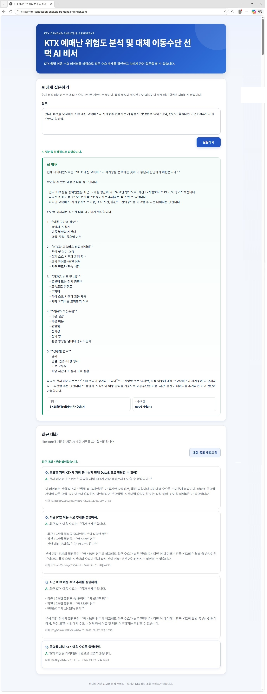

최종 질문이 Firestore에 저장된 뒤 최근 대화가 **4건 → 5건**으로 갱신되는 것까지 확인했습니다.

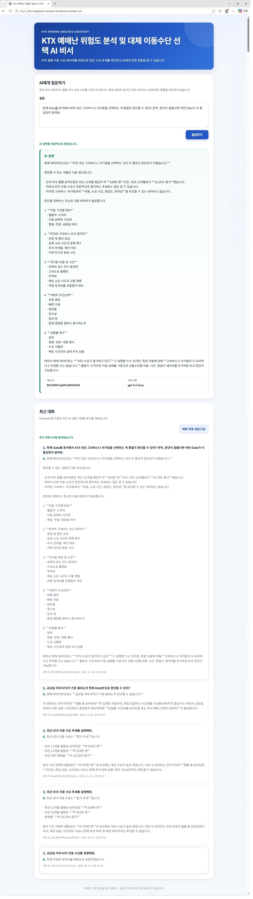

---

## 2. 프로젝트를 만든 이유

장거리 이동 시 KTX는 빠르고 편리하지만, 특정 시기에는 원하는 시간대의 좌석을 구하기 어려울 수 있습니다. KTX를 이용하지 못한 뒤 버스나 자가용으로 전환하려면 이동시간, 터미널 위치, 교통상황 등을 다시 확인해야 하므로 대응이 늦어질 수 있습니다.

이 프로젝트는 단순히 “KTX가 붐빈다”라고 단정하는 대신, **공개된 KTX 이용 데이터를 근거로 최근 수요 추세와 데이터의 한계를 함께 설명하고**, 사용자가 KTX·고속버스·자가용 같은 대체수단을 검토할 때 필요한 추가 정보까지 안내하는 것을 목표로 합니다.

---

## 3. 실제 사용 데이터

### 핵심 데이터

**한국철도공사 KTX 상하행 역별 승하차**

- 기간: **2010-01 ~ 2023-12**
- 원본: **6,953행 × 6열**
- 고유 월: **168개월**
- 고유 정차역: **73개**
- 결측치: **0건**
- 용도: 월별·역별·상행/하행 KTX 장기 수요 분석

가공 후 `ktx_demand.csv`는 상행/하행을 Long Format으로 변환하여 **13,906행**으로 구성했습니다.

### 보조 데이터

**한국교통안전공단 지역 간 대중교통 시간대별 철도 이용인원**

- 24시간대 데이터
- 평일 평균 / 토요일 / 일요일 비교 가능
- **KTX 전용 데이터가 아니므로 KTX 시간대별 수요로 단정하지 않고 보조지표로만 사용**

---

## 4. 데이터 전처리 및 분석

전처리 과정에서는 다음 작업을 수행했습니다.

1. CSV 인코딩을 순차적으로 처리
2. 필수 컬럼 검증
3. `운행년월`을 `YYYY-MM-01` 형식으로 변환
4. 승·하차 인원 숫자형 검증
5. 상행/하행 Wide 데이터를 Long Format으로 변환
6. 대표 분석 값 `value`를 승차인원으로 지정
7. Firestore/AI 설명용 `memo` 생성
8. UTF-8-SIG 형식으로 가공 결과 저장

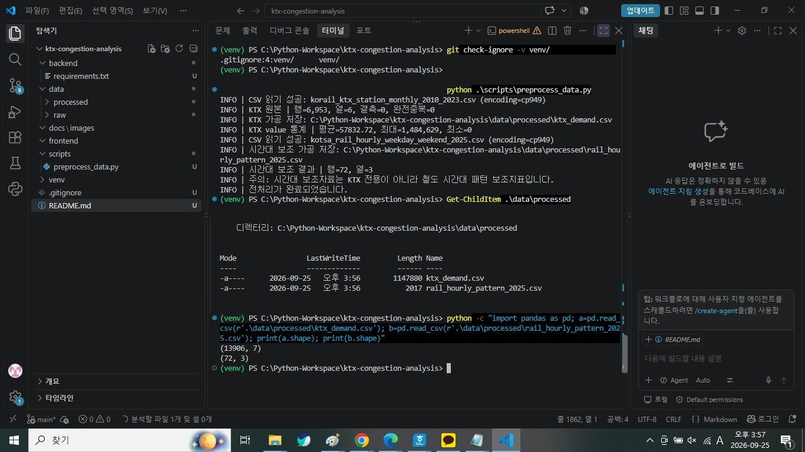

분석 결과의 주요 값은 다음과 같습니다.

| 항목 | 결과 |
|---|---:|
| 분석 기간 | 2010-01 ~ 2023-12 |
| 가공 레코드 | 13,906건 |
| 정차역 | 73개 |
| 2023-12 총승차인원 | 6,839,626명 |
| 2023-11 총승차인원 | 6,642,320명 |
| 전월 대비 | +2.97% |
| 최근 12개월 월평균 | 6,342,093.08명 |
| 직전 12개월 월평균 | 5,318,481.33명 |
| 최근 12개월 변화율 | +19.25% |
| 최근 추세 | 증가 |

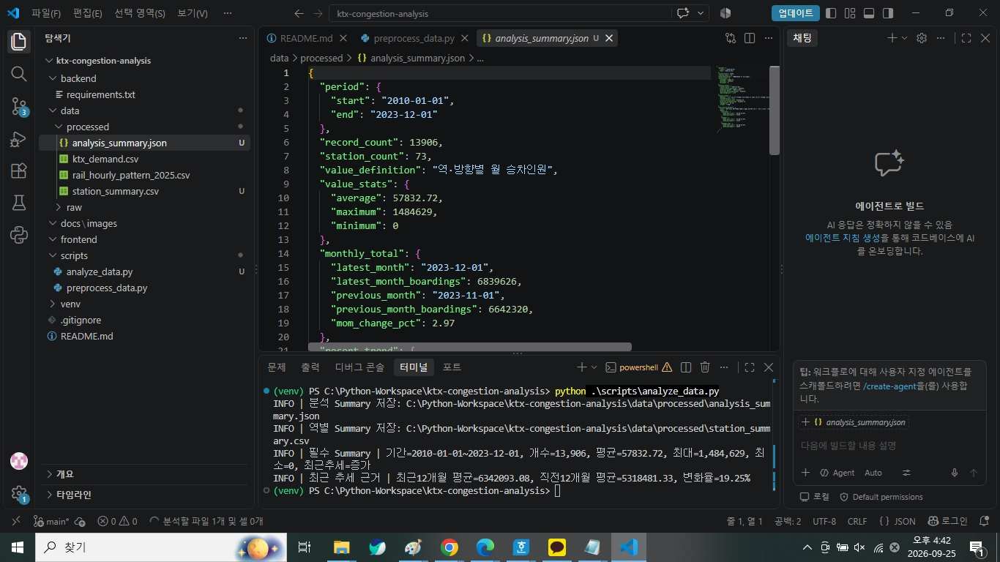

---

## 5. Firestore 데이터 저장

`monthly_summary.csv`의 전국 KTX 월 총승차인원 **168건**을 Firestore `data` 컬렉션에 저장했습니다.

```json
{
  "date": "2010-01-01",
  "value": 3219534,
  "memo": "전국 KTX 월 총승차인원"
}
```

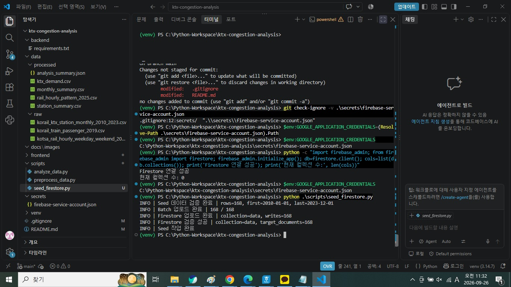

대화 내용은 `conversations` 컬렉션에 저장하며, Frontend의 최근 대화 목록에서 다시 조회할 수 있도록 구현했습니다.

---

## 6. Backend 구조

Backend는 **FastAPI + Pydantic + Firebase Admin SDK + OpenAI API**로 구성했습니다.

```text
backend/
├─ main.py
├─ models/
│  ├─ chat.py
│  ├─ conversation.py
│  └─ data.py
├─ routers/
│  ├─ chat.py
│  ├─ conversations.py
│  └─ data.py
└─ services/
   ├─ chat_service.py
   ├─ conversation_service.py
   ├─ data_service.py
   ├─ firestore_service.py
   ├─ openai_service.py
   └─ prompt_service.py
```

Router는 HTTP 요청·응답을 담당하고, Service는 Firestore 조회·요약·OpenAI 호출 등 비즈니스 로직을 담당하도록 분리했습니다.

---

## 7. API

### Data API

| Method | Endpoint | 기능 |
|---|---|---|
| GET | `/api/data` | 데이터 목록 조회 |
| POST | `/api/data` | 데이터 추가 |
| PUT | `/api/data/{document_id}` | 데이터 수정 |
| DELETE | `/api/data/{document_id}` | 데이터 삭제 |
| GET | `/api/data/summary` | 데이터 요약 |

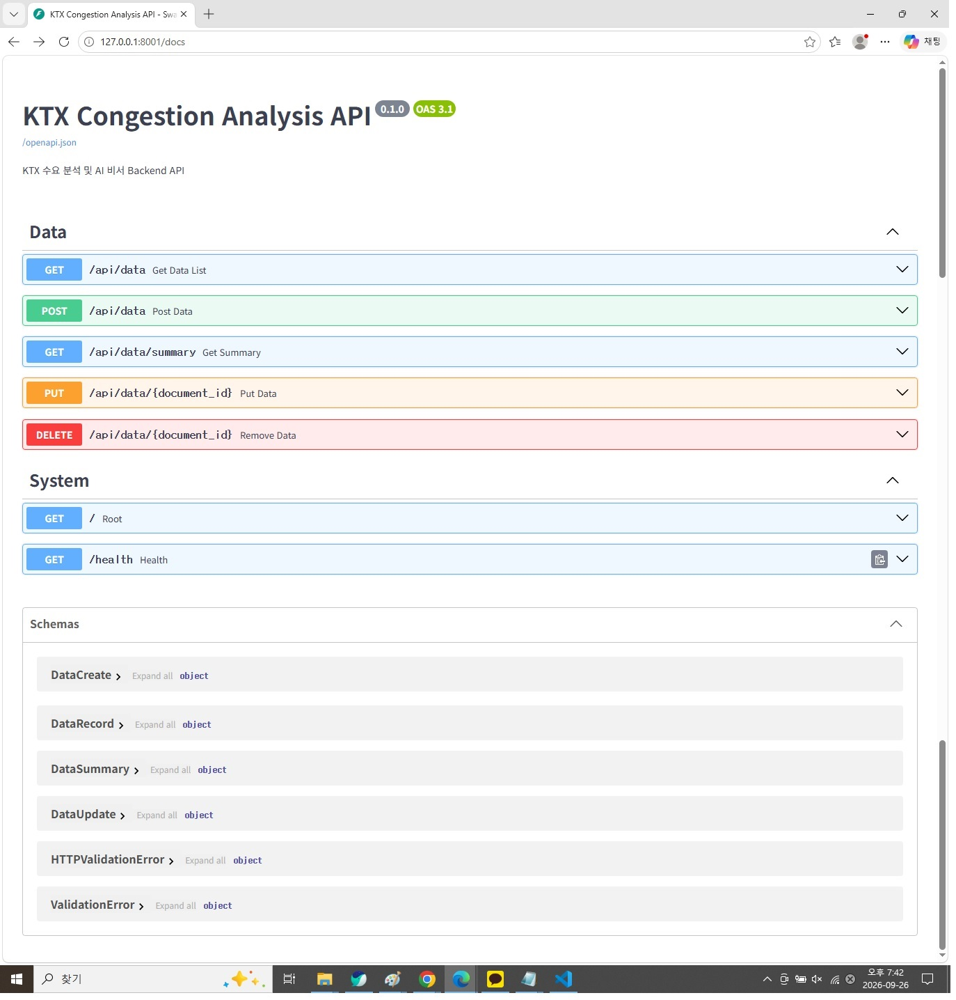

Swagger에서 POST 요청을 이용한 데이터 추가도 검증했습니다.

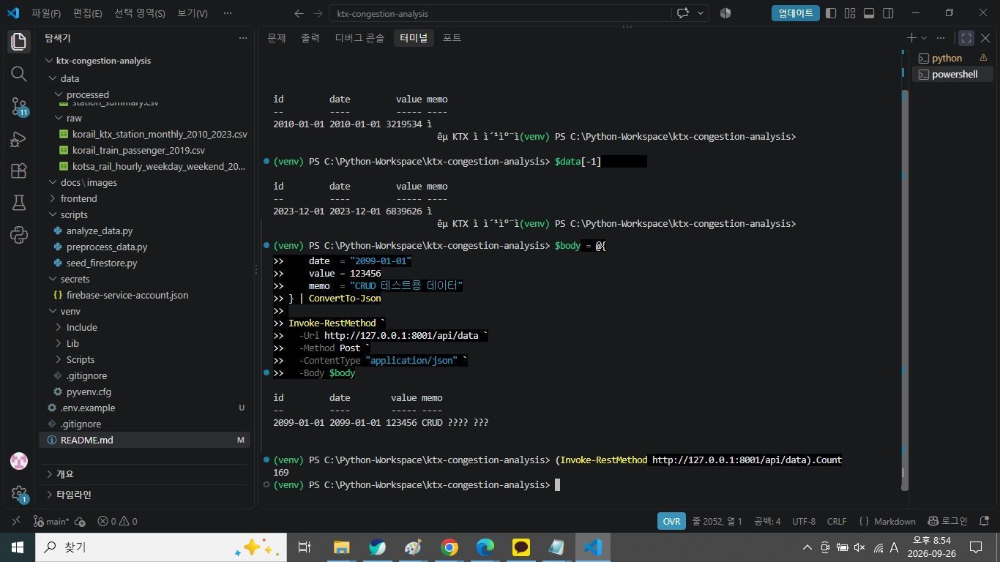

### Conversation API

| Method | Endpoint | 기능 |
|---|---|---|
| GET | `/api/conversations` | 최근 대화 목록 조회 |
| POST | `/api/conversations` | 대화 저장 |
| GET | `/api/conversations/{conversation_id}` | 특정 대화 조회 |
| DELETE | `/api/conversations/{conversation_id}` | 대화 삭제 |

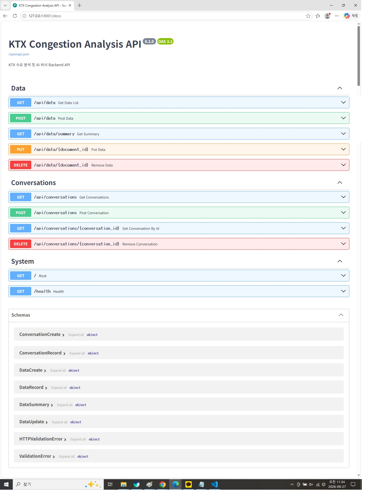

### Chat API

| Method | Endpoint | 기능 |
|---|---|---|
| POST | `/api/chat` | 데이터 Summary 기반 AI 답변 생성 및 대화 저장 |

---

## 8. AI Context Injection

OpenAI가 프로젝트의 Firestore 데이터를 자동으로 아는 것은 아니므로, Backend에서 현재 데이터의 Summary를 만든 뒤 **System Prompt에 주입**합니다.

핵심 규칙은 다음과 같습니다.

```text
- 현재 데이터가 월별 KTX 승차 수요라는 점을 명시
- 최근 12개월과 직전 12개월을 비교하여 추세 설명
- 데이터로 확인할 수 없는 요일·시간대 전용 KTX 수요는 단정하지 않음
- 실제 잔여 좌석이나 정확한 매진 확률을 제공한다고 표현하지 않음
- 대체 이동수단을 판단하기 위한 데이터가 부족하면 필요한 추가 데이터를 설명
```

Firestore Summary → System Prompt → OpenAI 응답까지 연결되는 테스트를 완료했습니다.

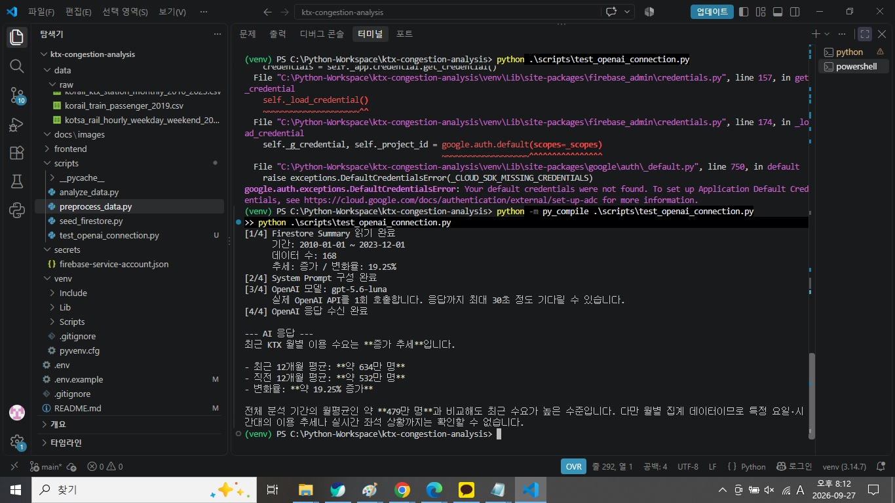

---

## 9. Frontend

Frontend는 Framework 없이 **HTML / CSS / JavaScript**로 구현했습니다.

주요 기능:

- AI 질문 입력
- 질문 전송 중 Loading 표시
- AI 답변 표시
- 사용 모델 표시
- Conversation ID 표시
- Firestore 최근 대화 목록 조회
- 대화 목록 새로고침
- 채팅 성공 후 최근 대화 자동 갱신

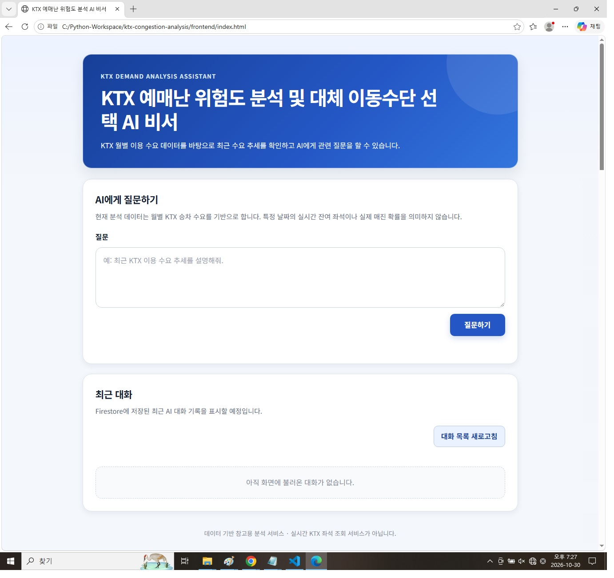

로컬 통합 테스트에서도 AI 응답과 최근 대화 자동 갱신을 확인했습니다.

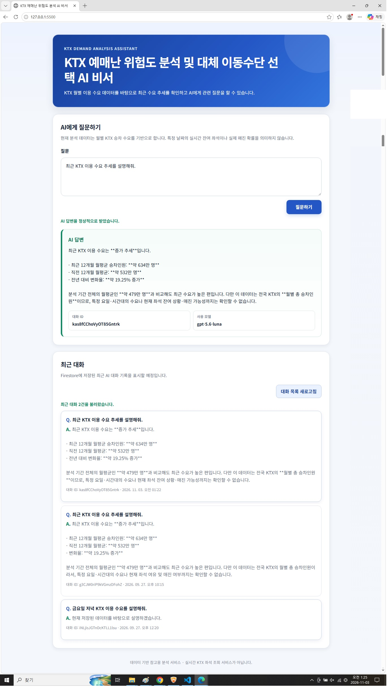

> 현재 데이터 CRUD 기능은 **Backend API/Swagger에서 구현·검증**했으며, 최종 Frontend는 AI 채팅과 대화 조회 기능에 집중했습니다.

---

## 10. 배포

### Backend — Render Web Service

- Service: `ktx-congestion-analysis`
- Region: Singapore
- Build: `pip install -r backend/requirements.txt`
- Start: `python -m uvicorn backend.main:app --host 0.0.0.0 --port $PORT`
- Health Check: `/health`

외부 Swagger 접속까지 확인했습니다.

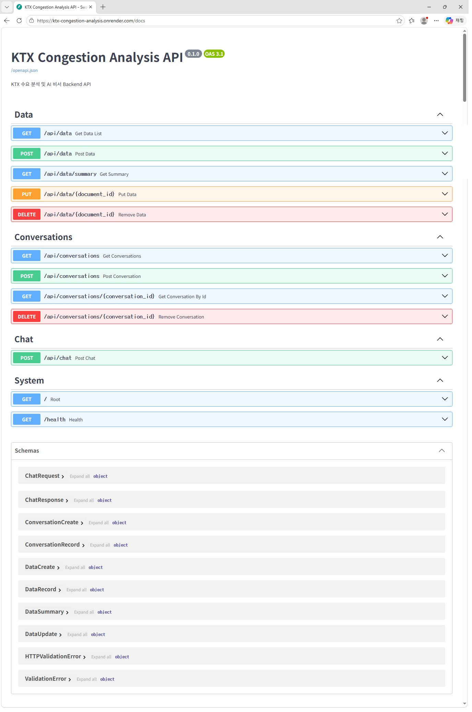

### Frontend — Render Static Site

- Service: `ktx-congestion-analysis-frontend`
- Root Directory: `frontend`
- Build: `echo "No build required"`
- Publish Directory: `.`

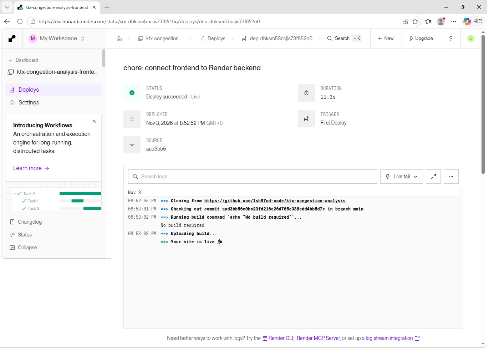

---

## 11. CORS 문제 해결

Frontend를 처음 외부 배포한 뒤 Backend 자체는 정상 동작했지만, 최근 대화 조회에서 `Failed to fetch`가 발생했습니다.

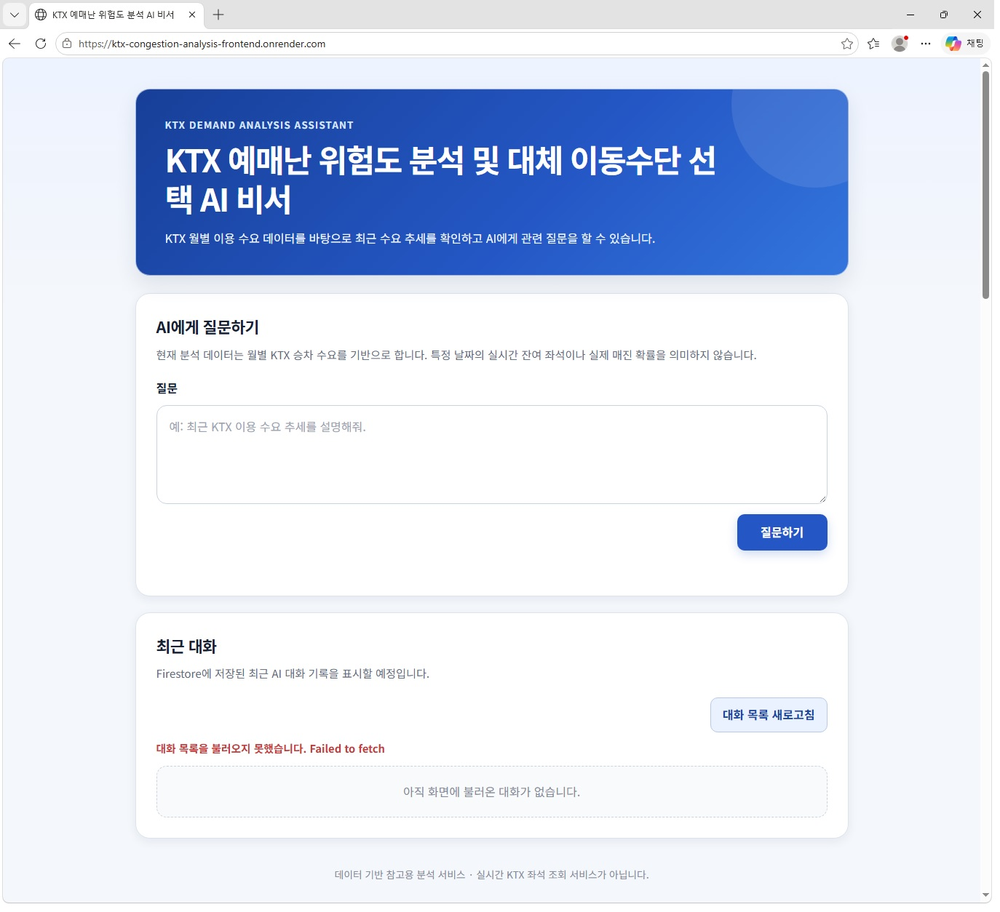

원인은 외부 Frontend Origin이 Backend CORS 허용 목록에 포함되지 않은 것이었습니다. Render Backend의 `ALLOWED_ORIGINS` 환경변수에 다음 Origin을 추가하고 재배포했습니다.

```text
http://127.0.0.1:5500
http://localhost:5500
https://ktx-congestion-analysis-frontend.onrender.com
```

재배포 후 외부 Frontend에서 최근 대화를 정상 조회했습니다.

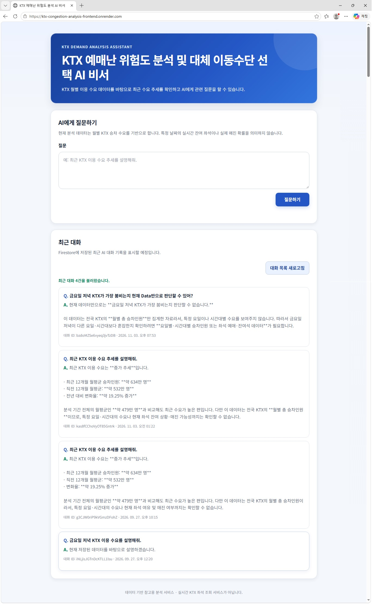

---

## 12. 최종 통합 테스트

최종 테스트에서는 이전 테스트와 다른 질문을 사용했습니다.

```text
현재 Data를 분석해서 KTX 대신 고속버스나 자가용을 선택하는 게 좋을지 판단할 수 있어?
만약, 판단이 힘들다면 어떤 Data가 더 필요한지 알려줘.
```

AI는 현재 데이터만으로 KTX·고속버스·자가용을 직접 비교해 최적 수단을 단정하기 어렵다고 설명했고, 비교를 위해 필요한 추가 데이터로 요금, 소요시간, 배차, 도로 교통상황 등을 제시했습니다.

이 답변은 현재 프로젝트 데이터의 한계를 과도하게 넘지 않는 결과입니다.


질문 처리 후 Firestore 저장 및 최근 대화 목록 갱신도 확인했습니다.


최종 확인된 통합 흐름:

```text
Render Frontend
    ↓ POST /api/chat
Render Backend (FastAPI)
    ↓ Summary / Prompt 구성
OpenAI API
    ↓ AI 답변
Firestore conversations 저장
    ↓
Frontend 최근 대화 갱신
```

---

## 13. 보안

비밀정보는 Git 저장소에 포함하지 않습니다.

- `.env` → `.gitignore`로 제외
- `secrets/` → `.gitignore`로 제외
- `secrets/firebase-service-account.json` → Git 추적 안 함
- Render에서는 `OPENAI_API_KEY`, `OPENAI_MODEL`, `FIREBASE_SERVICE_ACCOUNT_JSON`, `ALLOWED_ORIGINS`를 환경변수로 관리

최종 Git 확인 결과 `main`과 `origin/main`은 동일 commit을 가리키고, 비밀 파일은 Git 추적 대상이 아님을 확인했습니다.

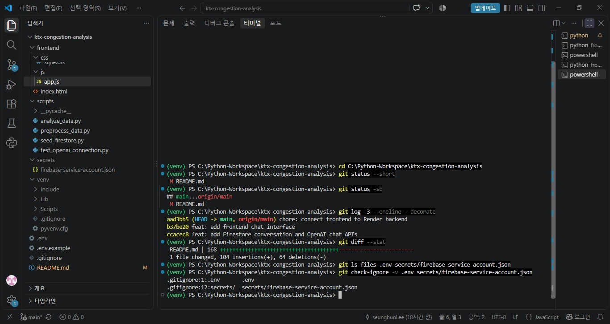

---

## 14. 기술 스택

| 영역 | 기술 |
|---|---|
| Language | Python |
| Backend | FastAPI / Uvicorn |
| Validation | Pydantic |
| Database | Firebase Firestore |
| AI | OpenAI API (`gpt-5.6-luna`) |
| Frontend | HTML / CSS / JavaScript |
| Backend Deploy | Render Web Service |
| Frontend Deploy | Render Static Site |
| Version Control | Git / GitHub |

---

## 15. 프로젝트 구조

```text
ktx-congestion-analysis/
├─ backend/
│  ├─ main.py
│  ├─ models/
│  ├─ routers/
│  ├─ services/
│  └─ requirements.txt
├─ data/
│  ├─ raw/
│  └─ processed/
├─ frontend/
│  ├─ index.html
│  ├─ css/
│  │  └─ style.css
│  └─ js/
│     └─ app.js
├─ image/                 # 보고서 및 README 증빙 이미지
├─ scripts/
│  ├─ analyze_data.py
│  ├─ preprocess_data.py
│  ├─ seed_firestore.py
│  └─ test_openai_connection.py
├─ secrets/               # Git 제외
├─ .env                   # Git 제외
├─ .env.example
├─ .gitignore
└─ README.md
```

---

## 16. 로컬 실행

### Backend

```powershell
git clone https://github.com/lsh97nd-code/ktx-congestion-analysis.git
cd ktx-congestion-analysis
python -m venv venv
.\venv\Scripts\Activate.ps1
pip install -r backend/requirements.txt
python -m uvicorn backend.main:app --reload --port 8001
```

환경변수는 실제 값을 README에 적지 않고 `.env` 또는 배포 환경변수에서 관리합니다.

### Frontend

현재 `frontend/js/app.js`는 Render Backend URL을 사용하도록 연결되어 있습니다. 로컬에서 정적 페이지를 확인하려면 예를 들어 다음과 같이 실행할 수 있습니다.

```powershell
python -m http.server 5500 -d frontend
```

브라우저에서 `http://127.0.0.1:5500`으로 접속합니다.

---

## 17. 현재 데이터로 할 수 있는 것과 할 수 없는 것

### 가능한 것

- 전국 KTX 월별 승차 수요 추세 설명
- 최근 12개월과 직전 12개월 비교
- 데이터 증가·감소 추세 설명
- 저장된 데이터에 근거한 자연어 질의응답
- 현재 데이터가 부족한 질문에 대해 부족한 데이터 종류 설명

### 현재 데이터만으로 직접 판단할 수 없는 것

- 특정 금요일 저녁 KTX가 가장 붐비는지 여부
- 특정 날짜의 실제 KTX 잔여 좌석
- 특정 열차의 정확한 매진 확률
- 실시간 고속버스·자가용과의 최적 이동수단 자동 비교

대체 이동수단을 실제로 자동 비교하려면 다음 데이터가 추가로 필요합니다.

- 출발지·도착지
- 희망 출발 시간
- KTX/고속버스 운임 및 배차
- 실제 좌석 또는 예매 가능 정보
- 자가용 유류비·통행료·주차비
- 예상 소요시간 및 교통정체 정보
- 날씨·연휴·특수일 정보

---

## 18. 최종 상태

| 항목 | 상태 |
|---|---|
| 데이터 전처리·분석 | ✅ 완료 |
| Firestore Data 적재 | ✅ 완료 |
| Data CRUD API | ✅ 완료 |
| Conversation API | ✅ 완료 |
| OpenAI Context Injection | ✅ 완료 |
| Chat API | ✅ 완료 |
| Frontend AI 채팅 | ✅ 완료 |
| 최근 대화 조회·갱신 | ✅ 완료 |
| Render Backend 배포 | ✅ 완료 |
| Render Frontend 배포 | ✅ 완료 |
| CORS 외부 통신 | ✅ 해결 |
| 외부 최종 통합 테스트 | ✅ 완료 |
| `.env` / Firebase Key Git 제외 | ✅ 확인 |

---

## 19. 보고서용 이미지 목록

보고서에 사용할 원본 파일명과 변경 후 파일명, 각 이미지의 의미는 [`IMAGE_INDEX.md`](IMAGE_INDEX.md)에 정리했습니다.

GitHub README의 이미지들은 모두 프로젝트 루트의 `image/` 폴더를 상대경로로 참조하므로, `README.md`와 `image/` 폴더를 함께 Commit하면 GitHub에서도 그대로 표시됩니다.
