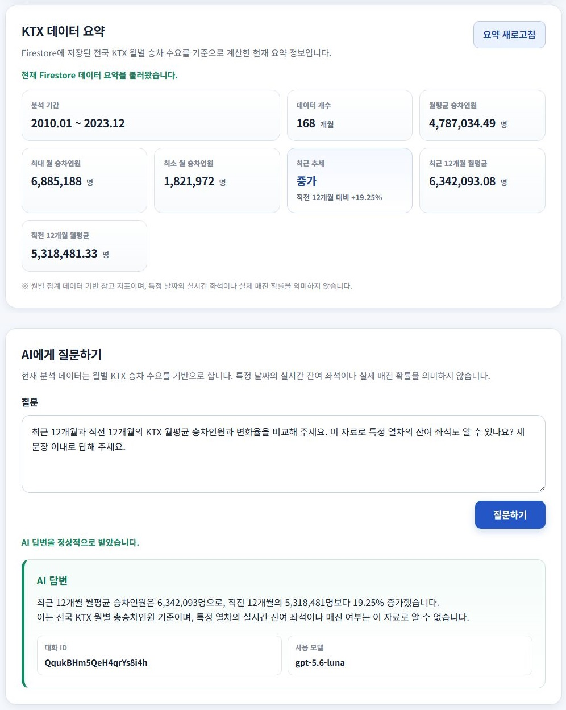
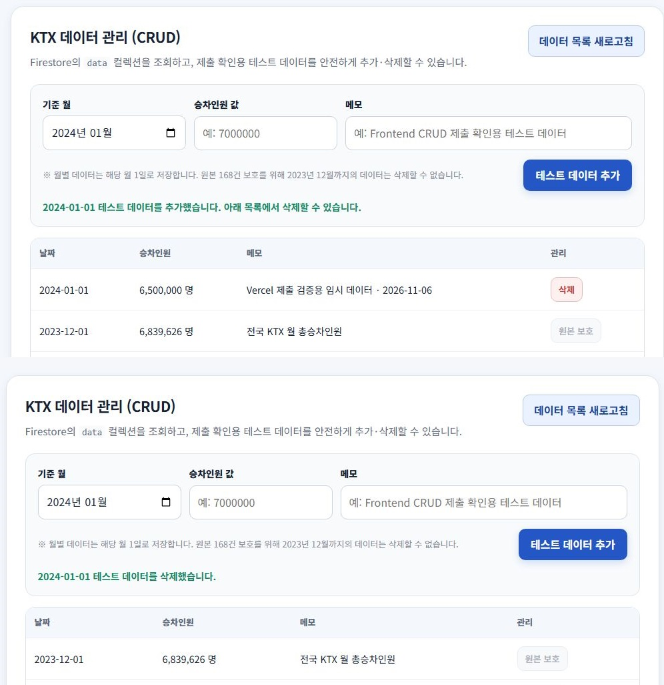
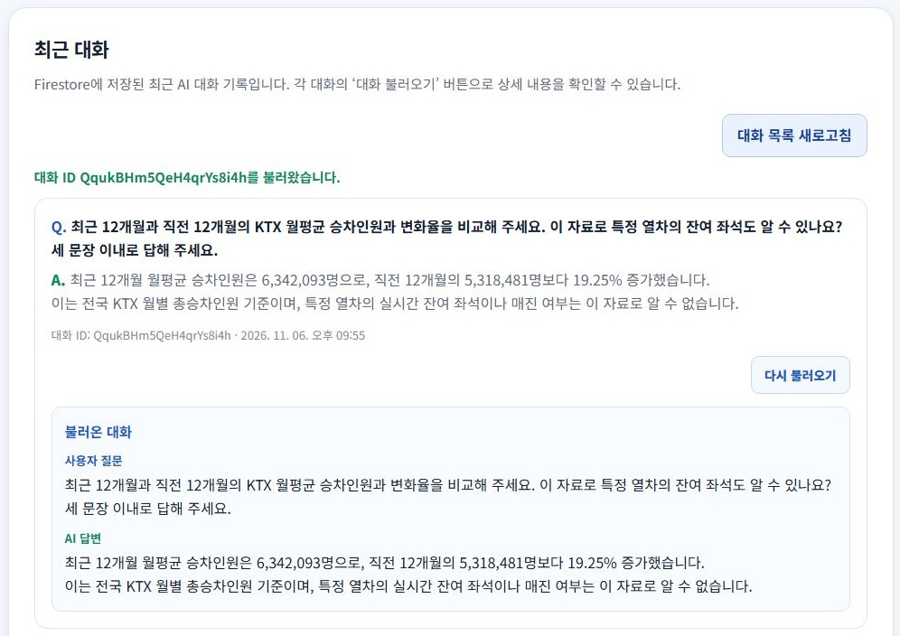

# KTX 예매난 위험도 분석 및 대체 이동수단 선택 AI 비서

> 과제: **AI Agent 개발: 나만의 AI 비서 구축**  
> 최종 업데이트: **2026-11-07**

KTX 월별 이용 수요 데이터를 분석하고, 분석 결과를 기반으로 사용자의 질문에 답하는 데이터 기반 AI 비서입니다. 현재 공개 데이터가 월 단위라는 한계를 명확히 반영하여 **실시간 좌석·정확한 매진 확률을 단정하지 않고 수요 집중도와 예매난 위험도를 설명**합니다.

- GitHub: <https://github.com/lsh97nd-code/ktx-congestion-analysis>
- Frontend (Vercel · 제출용): <https://ktx-congestion-analysis-frontend.vercel.app>
- Frontend (Render · 보조): <https://ktx-congestion-analysis-frontend.onrender.com>
- Backend API: <https://ktx-congestion-analysis.onrender.com>
- Swagger: <https://ktx-congestion-analysis.onrender.com/docs>
- Health Check: <https://ktx-congestion-analysis.onrender.com/health>

## 동료 평가자가 확인할 순서

[제출용 Vercel 사이트](https://ktx-congestion-analysis-frontend.vercel.app/)를 엽니다. Render 무료 백엔드가 유휴 상태였다면 첫 응답에 약 30~60초가 걸리며, 더 늦어질 수도 있습니다. 화면은 열렸는데 데이터가 보이지 않으면 잠시 기다린 뒤 **요약 새로고침**을 누르세요.

1. **데이터 요약과 AI 답변** — **KTX 데이터 요약**에서 최근·직전 구간 평균과 변화율을 확인합니다. **AI에게 질문하기**에서 “두 구간의 월평균 승차인원은 각각 몇 명이고, 이 값으로 이번 금요일의 잔여 좌석을 알 수 있어?”라고 묻습니다. 답변의 수치가 요약과 맞는지, 월별 수요만으로 실제 좌석을 알 수 없다고 설명하는지 확인합니다.
2. **대화 불러오기** — 답변 아래의 대화 ID를 확인합니다. **최근 대화**에서 방금 보낸 질문의 **대화 불러오기**를 누른 뒤, 표시된 ID와 질문·답변이 원래 대화와 일치하는지 확인합니다.
3. **테스트 데이터 관리** — **KTX 데이터 관리 (CRUD)**에서 아직 등록되지 않은 월(`2024-01`부터 선택 가능), 승차인원(예: `6500000`), 메모를 입력한 뒤 **테스트 데이터 추가**를 누릅니다. 새 행이 목록에 나타나고 요약 건수가 1 늘었는지 확인합니다. 값 수정은 [Swagger](https://ktx-congestion-analysis.onrender.com/docs)의 `PUT /api/data/{document_id}`에서 할 수 있습니다(문서 ID는 해당 월의 `YYYY-MM-01`). 확인을 마치면 직접 추가한 행을 삭제하고 건수가 원래대로 돌아오는지 봅니다.

공개 시연에서는 다른 방문자도 대화를 읽을 수 있으므로 질문에 개인정보를 넣지 마세요. 아래 화면은 촬영 당시의 결과입니다. 테스트 행이 추가되면 데이터 개수와 수요 지표가 달라질 수 있습니다.

---

## 1. Vercel Production 제출 증빙

2026년 11월 6~7일에 [제출용 Vercel 사이트](https://ktx-congestion-analysis-frontend.vercel.app/)에서 Render API와 Firestore를 연결해 검증했습니다. 아래 이미지는 실제 운영 브라우저에서 촬영한 화면입니다.

### 데이터 요약과 AI 채팅

2010년 1월부터 2023년 12월까지 **168개월**의 데이터가 표시됐습니다. 최근 12개월과 직전 12개월의 월평균 승차인원을 비교해 달라고 질문하자, AI는 각각 약 634만 명과 532만 명, 변화율 **+19.25%**를 제시했습니다. 또한 이 월별 통계로 특정 열차의 실시간 잔여 좌석을 확인할 수 없다고 답했습니다. 같은 화면의 요약 영역과 질문·답변 영역을 발췌해 위아래로 배치했습니다.



### 테스트 데이터 추가와 삭제

위쪽은 `2024-01-01`에 테스트 승차인원 `6,500,000`명을 추가한 직후, 아래쪽은 같은 행을 삭제한 직후입니다. 요약의 데이터 개수가 **168 → 169 → 168건**으로 바뀌었고, 삭제 후 목록에 표시된 가장 최근 월은 다시 원본 `2023-12-01`이었습니다.



### 저장된 대화 불러오기

질문 전송 후 최근 대화가 **7 → 8건**으로 늘었습니다. 새 항목의 ‘대화 불러오기’를 눌러 저장 ID `QqukBHm5QeH4qrYs8i4h`의 상세 내용을 조회했고, 불러온 질문과 답변이 위 채팅 원문과 일치했습니다.



Render의 `ADDITIONAL_ALLOWED_ORIGINS`에는 위 Vercel 주소를 설정했습니다. 운영 `/api/chat`의 CORS 사전 요청에서 HTTP 200과 `Access-Control-Allow-Origin: https://ktx-congestion-analysis-frontend.vercel.app`를 확인했습니다. 요약·추가·삭제·채팅·대화 상세 조회가 모두 완료됐습니다.

---

## 2. 프로젝트를 만든 이유

장거리 이동 시 KTX는 빠르고 편리하지만, 특정 시기에는 원하는 시간대의 좌석을 구하기 어려울 수 있습니다. KTX를 이용하지 못한 뒤 버스나 자가용으로 전환하려면 이동시간, 터미널 위치, 교통상황 등을 다시 확인해야 하므로 대응이 늦어질 수 있습니다.

이 프로젝트는 단순히 “KTX가 붐빈다”라고 단정하는 대신, **공개된 KTX 이용 데이터를 근거로 최근 수요 추세와 데이터의 한계를 함께 설명하고**, 사용자가 KTX·고속버스·자가용 같은 대체수단을 검토할 때 필요한 추가 정보까지 안내하는 것을 목표로 합니다.

---

## 3. 실제 사용 데이터

### 핵심 데이터

**한국철도공사 KTX 상하행 역별 승하차**

- 기간: **2010-01 ~ 2023-12**
- 원본: **6,953행 × 6열**
- 고유 월: **168개월**
- 고유 정차역: **73개**
- 결측치: **0건**
- 용도: 월별·역별·상행/하행 KTX 장기 수요 분석

가공 후 `ktx_demand.csv`는 상행/하행을 Long Format으로 변환하여 **13,906행**으로 구성했습니다.

### 보조 데이터

**한국교통안전공단 지역 간 대중교통 시간대별 철도 이용인원**

- 24시간대 데이터
- 평일 평균 / 토요일 / 일요일 비교 가능
- **KTX 전용 데이터가 아니므로 KTX 시간대별 수요로 단정하지 않고 보조지표로만 사용**

---

## 4. 데이터 전처리 및 분석

전처리 과정에서는 다음 작업을 수행했습니다.

1. CSV 인코딩을 순차적으로 처리
2. 필수 컬럼 검증
3. `운행년월`을 `YYYY-MM-01` 형식으로 변환
4. 승·하차 인원 숫자형 검증
5. 상행/하행 Wide 데이터를 Long Format으로 변환
6. 대표 분석 값 `value`를 승차인원으로 지정
7. Firestore/AI 설명용 `memo` 생성
8. UTF-8-SIG 형식으로 가공 결과 저장


분석 결과의 주요 값은 다음과 같습니다.

| 항목 | 결과 |
|---|---:|
| 분석 기간 | 2010-01 ~ 2023-12 |
| 가공 레코드 | 13,906건 |
| 정차역 | 73개 |
| 2023-12 총승차인원 | 6,839,626명 |
| 2023-11 총승차인원 | 6,642,320명 |
| 전월 대비 | +2.97% |
| 최근 12개월 월평균 | 6,342,093.08명 |
| 직전 12개월 월평균 | 5,318,481.33명 |
| 최근 12개월 변화율 | +19.25% |
| 최근 추세 | 증가 |


---

## 5. Firestore 데이터 저장

`monthly_summary.csv`의 전국 KTX 월 총승차인원 **168건**을 Firestore `data` 컬렉션에 저장했습니다.

```json
{
  "date": "2010-01-01",
  "value": 3219534,
  "memo": "전국 KTX 월 총승차인원"
}
```


대화 내용은 `conversations` 컬렉션에 저장하며, Frontend의 최근 대화 목록에서 다시 조회할 수 있도록 구현했습니다.

---

## 6. Backend 구조

Backend는 **FastAPI + Pydantic + Firebase Admin SDK + OpenAI API**로 구성했습니다.

```text
backend/
├─ main.py
├─ models/
│  ├─ chat.py
│  ├─ conversation.py
│  └─ data.py
├─ routers/
│  ├─ chat.py
│  ├─ conversations.py
│  └─ data.py
└─ services/
   ├─ chat_service.py
   ├─ conversation_service.py
   ├─ data_service.py
   ├─ firestore_service.py
   ├─ openai_service.py
   └─ prompt_service.py
```

[`routers/data.py`](backend/routers/data.py)는 월별 데이터 요청을 받아 원본 보호 규칙을 적용하고, [`models/data.py`](backend/models/data.py)는 등록 날짜가 매월 1일인지, 승차인원이 0 이상의 정수인지 검증합니다. [`services/data_service.py`](backend/services/data_service.py)가 Firestore 조회·저장과 통계를 담당합니다. [`main.py`](backend/main.py)에서 라우터를 등록하고 CORS를 설정합니다.

---

## 7. API

### Data API

| Method | Endpoint | 기능 |
|---|---|---|
| GET | `/api/data` | 데이터 목록 조회 |
| POST | `/api/data` | 데이터 추가 |
| PUT | `/api/data/{document_id}` | 데이터 수정 |
| DELETE | `/api/data/{document_id}` | 데이터 삭제 |
| GET | `/api/data/summary` | 데이터 요약 |


Swagger에서 POST 요청을 이용한 데이터 추가도 검증했습니다.


### Conversation API

| Method | Endpoint | 기능 |
|---|---|---|
| GET | `/api/conversations` | 최근 대화 목록 조회 |
| POST | `/api/conversations` | 대화 저장 |
| GET | `/api/conversations/{conversation_id}` | 특정 대화 조회 |
| DELETE | `/api/conversations/{conversation_id}` | 대화 삭제 |

최근 대화 목록은 기본 20건을 반환합니다. `?limit=1`부터 `?limit=100`까지 지정할 수 있습니다. 저장소 오류는 상세 인증정보를 노출하지 않는 503 응답으로 처리합니다.


### Chat API

| Method | Endpoint | 기능 |
|---|---|---|
| POST | `/api/chat` | 데이터 Summary 기반 AI 답변 생성 및 대화 저장 |

---

## 8. AI Context Injection

질문을 보낼 때마다 [채팅 서비스](backend/services/chat_service.py)가 Firestore의 현재 월별 데이터로 요약을 다시 계산합니다. [시스템 프롬프트](backend/services/prompt_service.py)에 분석 기간, 두 구간의 평균과 변화율, 월별 통계로 알 수 없는 항목을 넣어 질문과 함께 OpenAI에 보냅니다. 답변을 받으면 질문과 답변을 Firestore에 저장하고 대화 ID를 화면에 반환합니다.

핵심 규칙은 다음과 같습니다.

```text
- 현재 데이터가 월별 KTX 승차 수요라는 점을 명시
- 최근 구간과 직전 구간을 비교하여 추세 설명(기본값: 각 12개월)
- 데이터로 확인할 수 없는 요일·시간대 전용 KTX 수요는 단정하지 않음
- 실제 잔여 좌석이나 정확한 매진 확률을 제공한다고 표현하지 않음
- 대체 이동수단을 판단하기 위한 데이터가 부족하면 필요한 추가 데이터를 설명
```

Firestore Summary → System Prompt → OpenAI 응답까지 연결되는 테스트를 완료했습니다.


---

## 9. Frontend

Frontend는 Framework 없이 **HTML / CSS / JavaScript**로 구현했습니다.

주요 기능:

- AI 질문 입력
- 질문 전송 중 Loading 표시
- AI 답변 표시
- 사용 모델 표시
- Conversation ID 표시
- Firestore 최근 대화 목록 조회
- 대화 목록 새로고침
- 채팅 성공 후 최근 대화 자동 갱신


로컬 통합 테스트에서도 AI 응답과 최근 대화 자동 갱신을 확인했습니다.


Frontend는 데이터 요약·테스트 데이터 추가/삭제·AI 채팅·최근 대화 조회 및 불러오기를 제공합니다. 2010~2023 원본 데이터는 화면과 API에서 보호합니다.

---

## 10. 배포

### Backend — Render Web Service

- Service: `ktx-congestion-analysis`
- Region: Singapore
- Build: `pip install -r backend/requirements.txt`
- Start: `python -m uvicorn backend.main:app --host 0.0.0.0 --port $PORT`
- Health Check: `/health`

외부 Swagger 접속까지 확인했습니다.


### Frontend — Vercel (제출용)

- Production URL: <https://ktx-congestion-analysis-frontend.vercel.app>
- Project: `ktx-congestion-analysis-frontend`
- GitHub 저장소: `lsh97nd-code/ktx-congestion-analysis`, Production Branch: `main`
- Root Directory: `frontend`
- Framework Preset: `Other`
- Build Command: `node build.js`
- Output Directory: `dist`
- Production 환경변수: `API_BASE_URL=https://ktx-congestion-analysis.onrender.com`

빌드·출력 설정은 `frontend/vercel.json`에 정의합니다. `build.js`는 빌드 시 `API_BASE_URL`을 읽어 `dist/js/config.js`를 생성하므로 환경변수를 변경한 후에는 다시 배포해야 합니다. `frontend/dist/`는 Git에 올리지 않습니다.

### Frontend — Render Static Site (보조)


- Service: `ktx-congestion-analysis-frontend`
- Root Directory: `frontend`
- Build: `echo "No build required"`
- Publish Directory: `.`

위 무빌드 설정에서는 저장소에 포함된 `frontend/js/config.js`가 Render Backend URL을 제공합니다. 이 파일이 누락되면 설정 파일 요청이 404가 되어 앱이 실행되지 않습니다.

환경별 API 주소를 사용하려면 Root Directory는 `frontend`, Build Command는 `node build.js`, Publish Directory는 `dist`로 설정하고 `API_BASE_URL` 환경변수에 Backend의 절대 HTTP(S) URL을 넣습니다. Vercel은 `frontend/vercel.json`의 동일한 빌드 방식을 사용합니다. 환경변수는 **빌드 시점**에 적용되므로 변경 후 다시 빌드해야 합니다.


---

### 무료 서버 첫 접속 안내

첫 화면에 “무료 서버는 첫 접속 시 응답까지 약 30~60초가 걸릴 수 있으며, 더 지연될 수 있습니다”를 표시합니다. 프런트엔드 화면이 열려도 Render 백엔드를 깨우는 동안 데이터 응답은 늦을 수 있습니다. 이는 확정적인 최대 시간이 아닙니다. [Render 공식 안내](https://render.com/docs/free#spinning-down-on-idle)도 유휴 무료 서비스의 재시작에 약 1분이 필요하다고 설명합니다.

응답을 기다린 뒤 요약·데이터·대화 새로고침을 사용할 수 있습니다. 계속 실패하면 `/health`와 오류 메시지를 확인합니다. 콜드스타트와 CORS 오류는 원인과 조치가 다르므로 단순 대기로 CORS 문제가 해결되지는 않습니다.

## 11. CORS 문제 해결

Vercel의 실제 Production Origin은 `https://ktx-congestion-analysis-frontend.vercel.app`입니다. 기존 Render Backend의 `ALLOWED_ORIGINS`는 유지하고 다음 환경변수를 추가합니다.

```dotenv
ADDITIONAL_ALLOWED_ORIGINS=https://ktx-congestion-analysis-frontend.vercel.app
```

서버는 두 목록을 합쳐 중복과 끝 `/`를 정리합니다. 여러 주소는 쉼표로 구분합니다. 환경변수 변경 후 Backend 재배포가 필요하며, 주소별 Preview 도메인은 자동 허용하지 않습니다.

다음은 기존 Render Frontend 연결을 해결한 기록입니다.


Frontend를 처음 외부 배포한 뒤 Backend 자체는 정상 동작했지만, 최근 대화 조회에서 `Failed to fetch`가 발생했습니다.


원인은 외부 Frontend Origin이 Backend CORS 허용 목록에 포함되지 않은 것이었습니다. Render Backend의 `ALLOWED_ORIGINS` 환경변수에 다음 Origin을 추가하고 재배포했습니다.

```text
http://127.0.0.1:5500
http://localhost:5500
https://ktx-congestion-analysis-frontend.onrender.com
```

재배포 후 외부 Frontend에서 최근 대화를 정상 조회했습니다.


---

## 12. 기존 Render 통합 테스트 기록

최종 테스트에서는 이전 테스트와 다른 질문을 사용했습니다.

```text
현재 Data를 분석해서 KTX 대신 고속버스나 자가용을 선택하는 게 좋을지 판단할 수 있어?
만약, 판단이 힘들다면 어떤 Data가 더 필요한지 알려줘.
```

AI는 현재 데이터만으로 KTX·고속버스·자가용을 직접 비교해 최적 수단을 단정하기 어렵다고 설명했고, 비교를 위해 필요한 추가 데이터로 요금, 소요시간, 배차, 도로 교통상황 등을 제시했습니다.

이 답변은 현재 프로젝트 데이터의 한계를 과도하게 넘지 않는 결과입니다.


질문 처리 후 Firestore 저장 및 최근 대화 목록 갱신도 확인했습니다.


최종 확인된 통합 흐름:

```text
Vercel Frontend (Render 보조 사이트도 동일 API 사용)
    ↓ POST /api/chat
Render Backend (FastAPI)
    ↓ Summary / Prompt 구성
OpenAI API
    ↓ AI 답변
Firestore conversations 저장
    ↓
Frontend 최근 대화 갱신
```

---

## 13. 보안

현재 서비스는 **공개 시연용이며 사용자 인증을 사용하지 않습니다.** 모든 방문자가 저장된 대화를 조회·추가·삭제하고 2024년 이후 테스트 데이터를 변경할 수 있습니다. 대화에 개인정보·비밀정보를 입력하지 마세요. CORS는 사용자 인증이나 직접 API 호출 차단 기능이 아닙니다. Chat API에도 사용자별 호출 제한이 없어 공개 호출로 OpenAI 비용과 Firestore 사용량이 발생할 수 있습니다.

2010~2023 원본 데이터는 API에서 추가·수정·삭제를 403으로 거부합니다. 이 규칙은 사용자별 권한을 구분하지 않습니다. 입력 검증과 원본 보호를 확인한 내역은 [코드 검토 기록](docs/CODE_REVIEW_2026-11-05.md)에 정리했습니다. 운영 서비스로 전환하려면 사용자 인증, 대화 소유권, 관리자 권한 및 호출량 제한을 별도로 적용해야 합니다.

비밀정보는 Git 저장소에 포함하지 않습니다.

- `.env` → `.gitignore`로 제외
- `secrets/` → `.gitignore`로 제외
- `secrets/firebase-service-account.json` → Git 추적 안 함
- Render에서는 `OPENAI_API_KEY`, `OPENAI_MODEL`, `FIREBASE_SERVICE_ACCOUNT_JSON`, `ALLOWED_ORIGINS`를 환경변수로 관리

최종 Git 확인 결과 `main`과 `origin/main`은 동일 commit을 가리키고, 비밀 파일은 Git 추적 대상이 아님을 확인했습니다.


---

## 14. 기술 스택

| 영역 | 기술 |
|---|---|
| Language | Python |
| Backend | FastAPI / Uvicorn |
| Validation | Pydantic |
| Database | Firebase Firestore |
| AI | OpenAI API (`gpt-5.6-luna`) |
| Frontend | HTML / CSS / JavaScript |
| Backend Deploy | Render Web Service |
| Frontend Deploy | Vercel (제출용) / Render Static Site (보조) |
| Version Control | Git / GitHub |

---

## 15. 프로젝트 구조

```text
ktx-congestion-analysis/
├─ backend/
│  ├─ main.py
│  ├─ models/
│  ├─ routers/
│  ├─ services/
│  └─ requirements.txt
├─ data/
│  ├─ raw/
│  └─ processed/
├─ frontend/
│  ├─ index.html
│  ├─ build.js
│  ├─ vercel.json
│  ├─ css/
│  │  └─ style.css
│  └─ js/
│     ├─ app.js
│     └─ config.js
├─ image/                 # 보고서 및 README 증빙 이미지
├─ scripts/
│  ├─ analyze_data.py
│  ├─ preprocess_data.py
│  ├─ seed_firestore.py
│  └─ test_openai_connection.py
├─ secrets/               # Git 제외
├─ .env                   # Git 제외
├─ .env.example
├─ .gitignore
├─ IMAGE_INDEX.md
└─ README.md
```

---

## 16. 로컬 실행

### Backend

```powershell
git clone https://github.com/lsh97nd-code/ktx-congestion-analysis.git
cd ktx-congestion-analysis
python -m venv venv
.\venv\Scripts\Activate.ps1
pip install -r backend/requirements.txt
if (-not (Test-Path .env)) { Copy-Item .env.example .env }
python -m uvicorn backend.main:app --reload --port 8001
```

처음 실행할 때만 `.env.example`을 복사하고 실행 전 `.env`에 OpenAI/Firebase 설정을 입력합니다. 이미 `.env`가 있으면 덮어쓰지 않습니다. 환경변수는 실제 값을 README에 적지 않고 `.env` 또는 배포 환경변수에서 관리합니다. 프로젝트 루트의 `.env`만 읽으며 배포 환경변수가 우선합니다.

### Frontend

저장소의 `frontend/js/config.js`는 localhost/127.0.0.1에서는 로컬 Backend `http://127.0.0.1:8001`에 연결하고, 외부 호스트에서는 Render Backend에 연결합니다. Backend 실행 후 다음 명령으로 정적 페이지를 확인합니다.

```powershell
python -m http.server 5500 -d frontend
```

브라우저에서 `http://127.0.0.1:5500`으로 접속합니다.

API 주소를 지정해 빌드하려면 다음 명령을 사용합니다. Node.js가 필요하며 별도 npm 패키지 설치는 필요하지 않습니다.

```powershell
$env:API_BASE_URL = 'http://127.0.0.1:8001'
node frontend/build.js
python -m http.server 5500 -d frontend/dist
```

데이터 입력은 월 단위이며 API에는 `YYYY-MM-01`과 0 이상의 정수 승차인원을 전송합니다. 비교에 필요한 연속 월이 부족하면 추세는 `데이터 부족`, 직전 평균이 0이면 `계산 불가`입니다. 두 경우 모두 API의 변화율(`change_pct`)은 `null`입니다.

외부 API 호출 없이 회귀 테스트를 실행할 수 있습니다.

```powershell
pip install -r requirements-dev.txt
python -m pytest -q
node --test frontend/tests/*.test.js
```

---

## 17. 분석 기간 변경과 데이터 한계

### TREND_WINDOW_MONTHS 변경 방법

`TREND_WINDOW_MONTHS`는 비교 구간 한쪽에 포함할 **달력 월 수**입니다. 기본값 `12`는 최근 12개월 평균과 그 직전 12개월 평균을 비교하며, 연속 24개월이 필요합니다. 기준은 오늘이 아니라 **데이터에 저장된 마지막 월**입니다. 원본만 사용하면 기준 월은 2023-12입니다.

예를 들어 최근 3개월과 직전 3개월을 비교하려면 프로젝트 루트 `.env`에서 다음을 설정합니다.

```dotenv
TREND_WINDOW_MONTHS=3
```

로컬에서는 Backend를 재시작합니다. Render에서는 Backend → Environment에 같은 값을 설정하고 재배포합니다. 코드의 상수를 여러 곳에서 따로 바꿀 필요는 없습니다. 배포 환경변수가 `.env`보다 우선하며, 0·음수·소수·문자는 허용하지 않습니다.

| 설정 | 비교 | 필요한 연속 데이터 |
|---|---|---|
| `12` (기본) | 최근 12개월 vs 직전 12개월 | 24개월 |
| `3` | 최근 3개월 vs 직전 3개월 | 6개월 |
| `1` | 마지막 달 vs 직전 달 | 2개월 |

API `/api/data/summary`의 `trend_window_months`, `recent_window_avg`, `previous_window_avg`와 프런트엔드 라벨·AI 프롬프트가 같은 설정을 사용합니다. 기존 `recent_12_month_avg` / `previous_12_month_avg`는 호환성을 위해 유지하며 설정이 12가 아니면 `null`입니다. 구간에 누락된 월이 있으면 `데이터 부족`, 이전 평균이 0이면 `계산 불가`로 표시합니다.

오프라인 분석도 같은 설정을 사용합니다. 아래 명령은 로컬 분석 결과 파일을 다시 만들며 Firestore에는 업로드하지 않습니다.

```powershell
$env:TREND_WINDOW_MONTHS = '3'
python scripts/analyze_data.py
# 기본 12개월로 복원
$env:TREND_WINDOW_MONTHS = '12'
```

README의 19.25% 등 기존 분석 수치는 기본 12개월 기준입니다. 설정을 바꾸면 결과가 달라집니다.

### 왜 ‘최근 30일’ 분석에는 일별 데이터가 필요한가

현재 한 행은 월 전체 승차인원의 합계이므로 하루별 값이나 월 중간부터 시작하는 30일 구간을 복원할 수 없습니다. `TREND_WINDOW_MONTHS=1`은 마지막 **달력 월**이며 최근 30일과 다릅니다. `30`으로 설정하면 30개월이 됩니다.

최근 30일 분석에는 날짜별 승차인원과 충분히 최신인 일별 원천 데이터가 필요합니다. 최근 30일과 직전 30일을 비교하려면 연속 60일을 확보하고 날짜 범위·누락일 처리 기준을 정해야 합니다. 현재 월별 API는 매월 1일만 허용하므로, 일별 저장 모델·전처리·집계 로직·화면·AI 프롬프트를 함께 확장해야 합니다. 월 총합을 30으로 나눈 값은 실제 일별 관측값이 아닙니다.

### 실행·배포 환경변수 요약

| 위치 | 변수 | 용도 |
|---|---|---|
| Backend / Render | `OPENAI_API_KEY`, `OPENAI_MODEL` | AI 인증 및 모델 |
| Backend / Render | `FIREBASE_SERVICE_ACCOUNT_JSON` | 배포용 Firestore 인증 |
| Backend / 로컬 | `GOOGLE_APPLICATION_CREDENTIALS` | 로컬 서비스 계정 경로 |
| Backend | `ALLOWED_ORIGINS`, `ADDITIONAL_ALLOWED_ORIGINS` | 기존·추가 프런트엔드 Origin 허용 |
| Backend / 분석 스크립트 | `TREND_WINDOW_MONTHS` | 비교할 달력 월 수, 기본 12 |
| Frontend / Vercel | `API_BASE_URL` | 빌드 시 사용할 Backend URL |

비밀 값은 GitHub·README·프런트엔드 환경변수에 넣지 않습니다.

### 현재 데이터로 할 수 있는 것

- 전국 KTX 월별 승차 수요 추세 설명
- 최근 12개월과 직전 12개월 비교
- 데이터 증가·감소 추세 설명
- 저장된 데이터에 근거한 자연어 질의응답
- 현재 데이터가 부족한 질문에 대해 부족한 데이터 종류 설명

### 현재 데이터만으로 직접 판단할 수 없는 것

- 특정 금요일 저녁 KTX가 가장 붐비는지 여부
- 특정 날짜의 실제 KTX 잔여 좌석
- 특정 열차의 정확한 매진 확률
- 실시간 고속버스·자가용과의 최적 이동수단 자동 비교

대체 이동수단을 실제로 자동 비교하려면 다음 데이터가 추가로 필요합니다.

- 출발지·도착지
- 희망 출발 시간
- KTX/고속버스 운임 및 배차
- 실제 좌석 또는 예매 가능 정보
- 자가용 유류비·통행료·주차비
- 예상 소요시간 및 교통정체 정보
- 날씨·연휴·특수일 정보

---

## 18. 선택 과제 구현 현황

| 항목 | 현재 상태 |
|---|---|
| 추가 통계 지표 | **구현**. 요약 카드에 최근·직전 구간의 월평균 승차인원, 변화율, 추세를 표시합니다. |
| 추세 그래프 | 미구현. 추세는 수치와 텍스트로 표시합니다. |
| CSV·JSON 다운로드 | 미구현. 요약 API의 JSON 응답을 프런트엔드에서 파일로 내려받는 기능은 없습니다. |
| 다크 모드 전환 | 미구현. |
| Function Calling / MCP | 미구현. 백엔드가 질문마다 요약을 계산해 프롬프트에 넣습니다. |

[Swagger](https://ktx-congestion-analysis.onrender.com/docs)에서 `GET /api/data/summary`를 펼치고 **Try it out → Execute**를 누르면 요약 카드의 원본 값을 볼 수 있습니다. 다음은 원본 168개월과 기본 12개월 구간을 사용한 응답의 일부입니다.

```json
{
  "trend_window_months": 12,
  "recent_window_avg": 6342093.08,
  "previous_window_avg": 5318481.33,
  "change_pct": 19.25,
  "trend": "증가"
}
```

`change_pct`는 직전 구간 평균 대비 증감률입니다. [계산 코드](backend/services/data_service.py)는 이 값이 +3% 이상이면 ‘증가’, −3% 이하이면 ‘감소’, 그 사이면 ‘유지’로 분류합니다. 위 예시의 +19.25%는 **월평균 승차인원의 증가율**입니다.

---

## 19. 최종 상태

| 항목 | 상태 |
|---|---|
| 데이터 전처리·분석 | ✅ 완료 |
| Firestore Data 적재 | ✅ 완료 |
| Data CRUD API | ✅ 완료 |
| Conversation API | ✅ 완료 |
| OpenAI Context Injection | ✅ 완료 |
| Chat API | ✅ 완료 |
| Frontend AI 채팅 | ✅ 완료 |
| 최근 대화 조회·갱신 | ✅ 완료 |
| Render Backend 배포 | ✅ 완료 |
| Vercel Frontend 배포 | ✅ 제출용 Production 검증 |
| Render Frontend 배포 | 보조 사이트 유지 |
| 무료 서버 초기 지연 안내 | ✅ 첫 화면 표시 |
| 분석 기간 변경 | ✅ 환경변수 및 README 설명 |
| CORS 외부 통신 | ✅ 해결 |
| 외부 최종 통합 테스트 | ✅ 완료 |
| `.env` / Firebase Key Git 제외 | ✅ 확인 |

---

## 20. 보고서용 이미지 목록

제출용 Vercel 화면 30~32번과 기존 로컬·Render 화면의 촬영 환경 및 확인 내용을 [전체 이미지 색인](IMAGE_INDEX.md)에 정리했습니다.

- [Vercel 데이터 요약 + AI 채팅](image/30_vercel_summary_chat.jpg)
- [Vercel 테스트 데이터 추가·삭제](image/31_vercel_crud.jpg)
- [Vercel 대화 불러오기](image/32_vercel_conversation.jpg)
- [로컬 데이터 요약](image/17_Frontend_DataSummary_요약정보표시성공.jpg)
- [로컬 테스트 데이터 추가](image/21_Frontend_CRUD_테스트데이터추가성공.jpg)
- [로컬 특정 대화 불러오기](image/25_Frontend_Conversation_특정대화불러오기성공.jpg)
